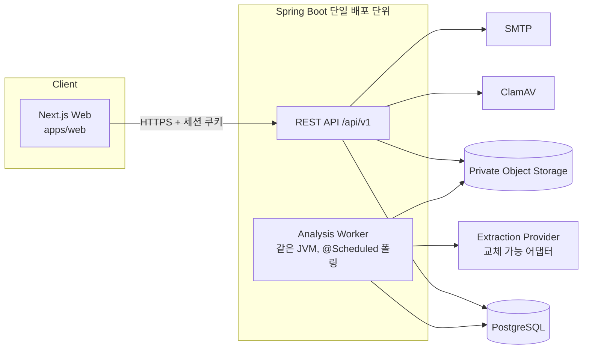

# 아키텍처

> 산출물 2(기술 스택·출시 플랫폼), 3(시스템 아키텍처·모듈 경계). 상태: **검토 요청**

## 1. 출시 플랫폼 선택

| 안 | 장점 | 단점 | 판단 |
|---|---|---|---|
| **A. Next.js 모바일 반응형 웹 (제안)** | 1인 개발 속도, 배포 즉시 반영, 데스크톱에서 원본 대조 화면이 넓음, 심사 없음 | 카메라 UX·푸시 제한, 홈 화면 설치는 PWA 수준 | **채택 제안** |
| B. React Native + Expo | 카메라·푸시·스토어 노출 | 스토어 심사(건강 앱 심사 강화), 빌드·배포 부담 | 앱스토어 우선이 확정되면 전환 |

카메라 촬영은 웹에서 `<input type="file" accept="image/*" capture="environment">`로 제공한다. API는 쿠키 세션 외에 토큰 인증을 나중에 추가할 수 있도록 인증 계층을 분리한다.

## 2. 기술 스택

| 영역 | 선택 | 버전(착수 시점 최신 안정판 확인) | 이유 |
|---|---|---|---|
| 언어/런타임 | Java 21 (LTS) | 21 | PRD 지정, 로컬 설치 확인됨 |
| 백엔드 | Spring Boot 3.x, Spring Security, Spring Data JPA, Spring Validation | 3.x 최신 | 표준 스택 |
| 세션 | Spring Session JDBC | — | 서버 측 세션, 즉시 무효화(로그아웃·탈퇴·비밀번호 변경) |
| DB | PostgreSQL 16 + Flyway | 16 | jsonb, 부분 인덱스, `FOR UPDATE SKIP LOCKED` 큐 |
| 빌드 | Gradle (Kotlin DSL) | — | |
| API 문서 | springdoc-openapi | — | 코드 → OpenAPI 생성, `docs/API.md`와 대조 |
| 오브젝트 스토리지 | S3 호환 (로컬 MinIO, 운영 S3 호환 서비스) | — | 비공개 버킷, 서명 URL |
| 악성코드 검사 | ClamAV (clamd) | — | 오픈소스, 컨테이너 운영 |
| 메일 | 로컬 Mailpit, 운영 SMTP 제공업체(미정) | — | |
| 프론트 | Next.js (App Router) + TypeScript + Tailwind CSS | 최신 안정판 | 디자인 토큰을 Tailwind 테마로 |
| 프론트 데이터 | TanStack Query | — | 분석 상태 폴링, 재시도 |
| 차트 | Recharts | — | 참고범위 밴드, 접근성 대체 표 |
| 테스트 | JUnit 5, AssertJ, Testcontainers(PostgreSQL·MinIO), MockMvc / Vitest, Testing Library, Playwright | — | |
| 배포 | Docker, GitHub Actions | — | |

## 3. 시스템 구성

- **단일 배포 단위**: API와 워커는 같은 Spring Boot 애플리케이션. `app.worker.enabled` 프로퍼티로 워커만/API만 띄울 수 있어 나중에 분리 가능.
- **Next.js는 BFF 없이** 백엔드 API를 직접 호출한다. 같은 상위 도메인(`app.example.kr` / `api.example.kr`) 또는 Next.js rewrites로 동일 출처를 구성해 쿠키·CORS를 단순화한다(로컬은 rewrites).

## 4. 모듈 경계 (모듈형 모놀리스)

패키지 루트 `kr.gumjin.note` (가칭)

| 모듈 | 책임 | 소유 테이블 | 의존 가능 |
|---|---|---|---|
| `global` | 오류 형식(ProblemDetail), 보안 설정, 공통 ID/시간, 로깅 마스킹 | — | — |
| `auth` | 가입, 이메일 인증, 로그인/로그아웃, 비밀번호 재설정, 로그인 시도 제한 | `email_verifications`, `password_reset_tokens`, `login_attempts`, `spring_session*` | user |
| `user` | 내 정보, 동의 이력, 탈퇴, 내보내기 | `users`, `user_consents` | checkup(삭제·내보내기 위임) |
| `checkup` | 검진 이벤트 CRUD, 상태 전이, 확정 | `checkups` | document, measurement |
| `document` | 업로드 검증, 스토리지, 분석 작업 큐·워커, 추출 어댑터 | `checkup_documents`, `document_pages`, `document_analysis_jobs` | — (결과는 이벤트/서비스 호출로 checkup·measurement에 전달) |
| `measurement` | 표준 항목 사전, 항목 결과, 수정 이력, 단위 정규화 | `measurement_definitions`, `measurement_unit_aliases`, `checkup_measurements`, `measurement_revisions` | — |
| `trend` | 확정값 기반 추이·비교 가능성 판단, 대시보드 조회 | (읽기 전용) | measurement, checkup |
| `healthinfo` (P1) | 검증된 설명 콘텐츠 | `health_information` | measurement |
| `goal` (P2) | 목표·실천 | `health_goals`, `goal_records` | — |

규칙
- 모듈 간 호출은 상대 모듈의 `*Service`(공개 API)로만 한다. 다른 모듈의 Repository·Entity 직접 사용 금지.
- 각 모듈 내부: `controller / service / domain / repository`. 필요해질 때만 세분화.
- 경계 위반은 ArchUnit 테스트로 검사한다(Sprint 1에 규칙 1~2개부터).

## 5. 요청 처리 공통 규칙

- **소유권 검증**: 건강정보 조회는 항상 `findByIdAndUserId(id, currentUserId)` 형태. 없거나 타인 소유면 동일하게 `404 Not Found`(존재 여부 노출 방지).
- **외부 ID**: UUID(v7 또는 v4)를 PK로 사용. 순번 노출 없음. 추측 불가성은 보조 수단이며 소유권 검증을 대체하지 않는다.
- **낙관적 잠금**: `checkups.version`. 확정·수정 API는 `If-Match`(ETag) 또는 요청 본문 `version` 필수 → 충돌 시 `409`.
- **멱등성**: 업로드 API는 `Idempotency-Key` 헤더 지원(24시간). 워커 결과 저장은 `job_id` 기준 upsert.
- **시간**: DB `timestamptz`, API는 ISO-8601 UTC. 검진일(`exam_date`)은 `date`(시간대 없음).

## 6. 배포·환경

| 환경 | 구성 |
|---|---|
| local | `infrastructure/compose.yaml`: postgres, minio, clamav, mailpit. 백엔드·웹은 호스트에서 실행 |
| CI | GitHub Actions: backend `./gradlew check`(Testcontainers), web `lint/typecheck/test/build` |
| staging/prod | 미정. 국내 리전 권장. 비밀정보는 환경변수/시크릿 매니저, 저장소에 커밋 금지 |

## 7. 아키텍처 의사결정 기록 (ADR 요약)

| ID | 결정 | 대안 | 이유 |
|---|---|---|---|
| ADR-1 | 모듈형 모놀리스 | MSA | 1인 개발, 트랜잭션 단순 |
| ADR-2 | DB 기반 작업 큐 (`SKIP LOCKED`) | SQS/RabbitMQ | 인프라 최소화, 트랜잭션 일관성. 처리량 증가 시 교체 |
| ADR-3 | 서버 세션 + HttpOnly 쿠키 | JWT(localStorage) | XSS 시 토큰 탈취 방지, 즉시 무효화 |
| ADR-4 | 추출 결과는 별도 컬럼에 원본 보존 | 덮어쓰기 | 추적성·감사 |
| ADR-5 | 단위 변환 미구현(MVP) | 변환 테이블 | 잘못된 변환 위험 > 편의 |
| ADR-6 | 추출 제공업체는 어댑터 + Fake | 처음부터 특정 벤더 | 평가 전 락인 방지, 테스트 결정성 |
