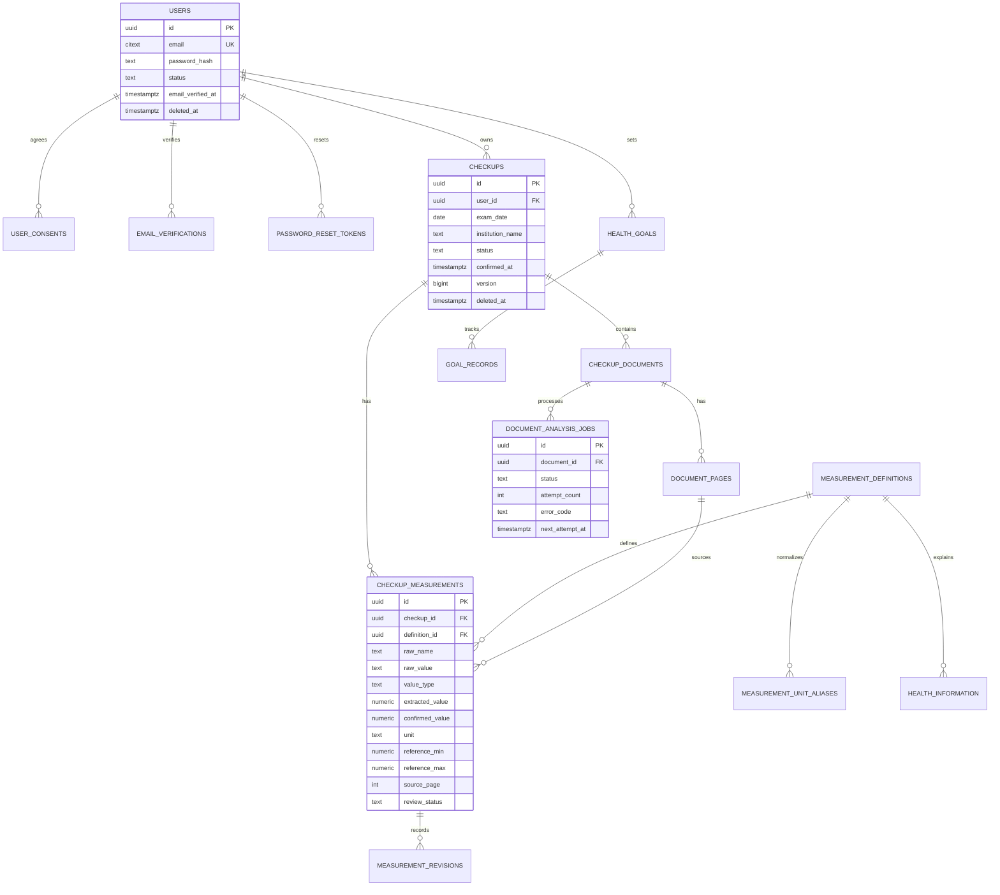
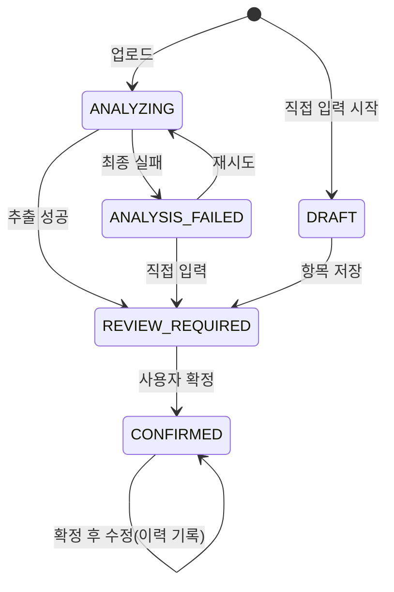

# 데이터베이스 설계

> 산출물 4. ERD 및 Flyway 마이그레이션 초안. 상태: **검토 요청**
> PostgreSQL 16 기준. 실제 마이그레이션은 Sprint별로 나눠 `backend/src/main/resources/db/migration/`에 추가한다.

## 1. PRD 대비 변경점

| 변경 | 이유 |
|---|---|
| 작업 상태와 검진 상태 분리 | ANALYSIS.md A1 |
| `document_pages` 추가 | 다중 이미지·PDF 페이지별 출처, 미리보기 |
| `checkup_measurements`에 `value_type`, `raw_*` 원문 컬럼, 범위 포함 여부, `method`, `source`, `review_status`, `needs_review` 추가 | 비수치 결과, 원문 보존, 수동 추가 항목 구분 |
| `measurement_unit_aliases` 추가 | 단위 표기 정규화 |
| `email_verifications`, `password_reset_tokens`, `login_attempts` 추가 | AUTH-001 |
| 소프트 삭제 `deleted_at` + 비동기 파기 | 오브젝트 스토리지 삭제는 트랜잭션 밖 → 파기 작업으로 보장 |
| `version` (낙관적 잠금) | 동시 수정 충돌 |
| PK는 UUID | 추측 어려운 외부 ID |

## 2. ERD



## 3. 상태 값

| 테이블.컬럼 | 값 |
|---|---|
| `users.status` | `PENDING_VERIFICATION`, `ACTIVE`, `LOCKED`, `WITHDRAWN` |
| `checkups.status` | `DRAFT`, `ANALYZING`, `REVIEW_REQUIRED`, `CONFIRMED`, `ANALYSIS_FAILED` |
| `document_analysis_jobs.status` | `PENDING`, `PROCESSING`, `SUCCEEDED`, `FAILED`, `CANCELLED` |
| `checkup_measurements.review_status` | `PENDING`, `CONFIRMED`, `EXCLUDED` |
| `checkup_measurements.source` | `EXTRACTED`, `MANUAL` |
| `checkup_measurements.value_type` | `NUMERIC`, `TEXT` |

검진 상태 전이



## 4. 마이그레이션 초안

### V1__auth_users.sql (Sprint 1)

```sql
CREATE EXTENSION IF NOT EXISTS citext;

CREATE TABLE users (
    id                 uuid PRIMARY KEY,
    email              citext      NOT NULL,
    password_hash      text        NOT NULL,
    status             text        NOT NULL CHECK (status IN ('PENDING_VERIFICATION','ACTIVE','LOCKED','WITHDRAWN')),
    email_verified_at  timestamptz,
    created_at         timestamptz NOT NULL DEFAULT now(),
    updated_at         timestamptz NOT NULL DEFAULT now(),
    deleted_at         timestamptz
);
-- 탈퇴 후 같은 이메일 재가입 허용: 활성 계정에만 유일성
CREATE UNIQUE INDEX ux_users_email_active ON users (email) WHERE deleted_at IS NULL;

CREATE TABLE user_consents (
    id            uuid PRIMARY KEY,
    user_id       uuid        NOT NULL REFERENCES users(id),
    consent_type  text        NOT NULL CHECK (consent_type IN ('TERMS','PRIVACY','SENSITIVE_HEALTH_DATA','MARKETING')),
    version       text        NOT NULL,
    agreed_at     timestamptz NOT NULL,
    revoked_at    timestamptz
);
CREATE INDEX ix_user_consents_user ON user_consents (user_id, consent_type);

CREATE TABLE email_verifications (
    id             uuid PRIMARY KEY,
    user_id        uuid        NOT NULL REFERENCES users(id) ON DELETE CASCADE,
    code_hash      text        NOT NULL,          -- 코드 원문 저장 금지
    expires_at     timestamptz NOT NULL,
    attempt_count  int         NOT NULL DEFAULT 0,
    consumed_at    timestamptz,
    created_at     timestamptz NOT NULL DEFAULT now()
);
CREATE INDEX ix_email_verifications_user ON email_verifications (user_id, created_at DESC);

CREATE TABLE password_reset_tokens (
    id           uuid PRIMARY KEY,
    user_id      uuid        NOT NULL REFERENCES users(id) ON DELETE CASCADE,
    token_hash   text        NOT NULL UNIQUE,     -- SHA-256(token)
    expires_at   timestamptz NOT NULL,
    consumed_at  timestamptz,
    created_at   timestamptz NOT NULL DEFAULT now()
);

CREATE TABLE login_attempts (
    id           bigserial PRIMARY KEY,
    email_hash   text        NOT NULL,            -- HMAC(email), 원문 저장 안 함
    ip_hash      text        NOT NULL,
    succeeded    boolean     NOT NULL,
    attempted_at timestamptz NOT NULL DEFAULT now()
);
CREATE INDEX ix_login_attempts_email ON login_attempts (email_hash, attempted_at DESC);
CREATE INDEX ix_login_attempts_ip    ON login_attempts (ip_hash, attempted_at DESC);
```

### V2__spring_session.sql (Sprint 1)

Spring Session JDBC 공식 스키마(`schema-postgresql.sql`)를 그대로 복사해 Flyway로 관리한다(`spring.session.jdbc.initialize-schema=never`).

### V3__checkups_documents.sql (Sprint 2)

```sql
CREATE TABLE checkups (
    id                uuid PRIMARY KEY,
    user_id           uuid        NOT NULL REFERENCES users(id),
    exam_date         date,                         -- 추출 전/실패 시 null 허용, 확정 시 필수(앱 검증)
    institution_name  text,
    status            text        NOT NULL CHECK (status IN ('DRAFT','ANALYZING','REVIEW_REQUIRED','CONFIRMED','ANALYSIS_FAILED')),
    confirmed_at      timestamptz,
    version           bigint      NOT NULL DEFAULT 0,
    created_at        timestamptz NOT NULL DEFAULT now(),
    updated_at        timestamptz NOT NULL DEFAULT now(),
    deleted_at        timestamptz
);
CREATE INDEX ix_checkups_user_exam ON checkups (user_id, exam_date DESC NULLS LAST, id) WHERE deleted_at IS NULL;

CREATE TABLE checkup_documents (
    id                 uuid PRIMARY KEY,
    checkup_id         uuid        NOT NULL REFERENCES checkups(id),
    storage_key        text        NOT NULL UNIQUE,  -- 랜덤, 사용자 정보·원본 파일명 미포함
    original_filename  text,                         -- 표시용. 개인정보 포함 가능 → 암호화 대상 검토
    mime_type          text        NOT NULL,
    size_bytes         bigint      NOT NULL,
    sha256             text        NOT NULL,
    page_count         int         NOT NULL,
    uploaded_at        timestamptz NOT NULL DEFAULT now(),
    deleted_at         timestamptz
);
CREATE INDEX ix_checkup_documents_checkup ON checkup_documents (checkup_id);
CREATE INDEX ix_checkup_documents_sha ON checkup_documents (sha256);

CREATE TABLE document_pages (
    id                  uuid PRIMARY KEY,
    document_id         uuid NOT NULL REFERENCES checkup_documents(id),
    page_number         int  NOT NULL,              -- 1부터, 검진 내 전체 페이지 기준
    rendered_storage_key text,                      -- 미리보기 PNG
    width_px            int,
    height_px           int,
    UNIQUE (document_id, page_number)
);

CREATE TABLE document_analysis_jobs (
    id               uuid PRIMARY KEY,
    document_id      uuid        NOT NULL REFERENCES checkup_documents(id),
    status           text        NOT NULL CHECK (status IN ('PENDING','PROCESSING','SUCCEEDED','FAILED','CANCELLED')),
    attempt_count    int         NOT NULL DEFAULT 0,
    max_attempts     int         NOT NULL DEFAULT 3,
    next_attempt_at  timestamptz NOT NULL DEFAULT now(),
    locked_at        timestamptz,
    locked_by        text,
    provider         text,
    provider_model_version text,
    error_code       text,
    created_at       timestamptz NOT NULL DEFAULT now(),
    finished_at      timestamptz
);
CREATE INDEX ix_jobs_pending ON document_analysis_jobs (next_attempt_at) WHERE status = 'PENDING';
-- 문서당 진행 중 작업은 하나
CREATE UNIQUE INDEX ux_jobs_active_per_doc ON document_analysis_jobs (document_id) WHERE status IN ('PENDING','PROCESSING');

CREATE TABLE idempotency_keys (
    user_id       uuid        NOT NULL REFERENCES users(id),
    key           text        NOT NULL,
    request_hash  text        NOT NULL,
    response_ref  uuid,                             -- 생성된 checkup id
    created_at    timestamptz NOT NULL DEFAULT now(),
    PRIMARY KEY (user_id, key)
);
```

### V4__measurements.sql (Sprint 3)

```sql
CREATE TABLE measurement_definitions (
    id              uuid PRIMARY KEY,
    code            text NOT NULL UNIQUE,           -- 'FASTING_GLUCOSE'
    name_ko         text NOT NULL,
    canonical_unit  text,                           -- null: 단위 없음(BMI 등은 'kg/m2')
    category        text NOT NULL,                  -- BODY, BLOOD_PRESSURE, GLUCOSE, LIPID, LIVER, KIDNEY
    value_type      text NOT NULL DEFAULT 'NUMERIC',
    aliases         text[] NOT NULL DEFAULT '{}',   -- 정규화된 원문 항목명
    sort_order      int  NOT NULL
);

CREATE TABLE measurement_unit_aliases (
    alias           text PRIMARY KEY,               -- 'mg/dl'
    canonical_unit  text NOT NULL                   -- 'mg/dL'
);

CREATE TABLE checkup_measurements (
    id                       uuid PRIMARY KEY,
    checkup_id               uuid        NOT NULL REFERENCES checkups(id),
    definition_id            uuid        REFERENCES measurement_definitions(id),  -- 미매핑이면 null
    source                   text        NOT NULL CHECK (source IN ('EXTRACTED','MANUAL')),
    job_id                   uuid        REFERENCES document_analysis_jobs(id),
    -- 원문 (추출 결과, 수정 불가)
    raw_name                 text,
    raw_value                text,
    raw_unit                 text,
    raw_reference_text       text,
    raw_judgement            text,
    source_page              int,
    source_bbox              jsonb,
    confidence               numeric(4,3),
    -- 정규화된 추출값 (수정 불가)
    value_type               text        NOT NULL CHECK (value_type IN ('NUMERIC','TEXT')),
    extracted_value          numeric(12,4),
    extracted_text_value     text,
    -- 확정값 (사용자 검증)
    display_name             text        NOT NULL,
    confirmed_value          numeric(12,4),
    confirmed_text_value     text,
    unit                     text,
    reference_min            numeric(12,4),
    reference_max            numeric(12,4),
    reference_min_inclusive  boolean,
    reference_max_inclusive  boolean,
    method                   text,
    review_status            text        NOT NULL CHECK (review_status IN ('PENDING','CONFIRMED','EXCLUDED')),
    needs_review             boolean     NOT NULL DEFAULT false,
    review_reasons           text[]      NOT NULL DEFAULT '{}',
    confirmed_at             timestamptz,
    created_at               timestamptz NOT NULL DEFAULT now(),
    updated_at               timestamptz NOT NULL DEFAULT now()
);
CREATE INDEX ix_measurements_checkup ON checkup_measurements (checkup_id);
-- 추이 조회: 확정된 값만
CREATE INDEX ix_measurements_trend ON checkup_measurements (definition_id, checkup_id) WHERE review_status = 'CONFIRMED';

CREATE TABLE measurement_revisions (
    id              uuid PRIMARY KEY,
    measurement_id  uuid        NOT NULL REFERENCES checkup_measurements(id) ON DELETE CASCADE,
    field           text        NOT NULL,           -- 'confirmed_value', 'unit', 'review_status' ...
    before_value    text,
    after_value     text,
    changed_by      uuid        NOT NULL REFERENCES users(id),
    changed_at      timestamptz NOT NULL DEFAULT now()
);
```

### V5__seed_measurement_definitions.sql (Sprint 3)

PRD AI-001 초기 대상 17개 항목:

| code | name_ko | canonical_unit | category |
|---|---|---|---|
| HEIGHT | 키 | cm | BODY |
| WEIGHT | 체중 | kg | BODY |
| BMI | 체질량지수 | kg/m2 | BODY |
| WAIST | 허리둘레 | cm | BODY |
| SBP | 수축기 혈압 | mmHg | BLOOD_PRESSURE |
| DBP | 이완기 혈압 | mmHg | BLOOD_PRESSURE |
| FASTING_GLUCOSE | 공복혈당 | mg/dL | GLUCOSE |
| HBA1C | 당화혈색소 | % | GLUCOSE |
| TOTAL_CHOLESTEROL | 총콜레스테롤 | mg/dL | LIPID |
| HDL | HDL 콜레스테롤 | mg/dL | LIPID |
| LDL | LDL 콜레스테롤 | mg/dL | LIPID |
| TRIGLYCERIDES | 중성지방 | mg/dL | LIPID |
| AST | AST | U/L | LIVER |
| ALT | ALT | U/L | LIVER |
| GGT | 감마지티피 | U/L | LIVER |
| CREATININE | 크레아티닌 | mg/dL | KIDNEY |
| EGFR | eGFR | mL/min/1.73m2 | KIDNEY |

별칭(aliases)은 Q2(첫 지원 양식)가 확정되면 해당 양식의 표기를 기준으로 채운다.

### 이후

- V6 `health_information` (P1): `definition_id, title, body_md, sources jsonb, version, reviewed_by, reviewed_at, medical_review_status`.
- V7 `health_goals`, `goal_records` (P2).
- `data_purge_jobs`: 삭제된 검진/탈퇴 계정의 오브젝트 파기 작업 큐(Sprint 4).
- `user_exports`: 데이터 내보내기 작업(`user_id, format, status, storage_key, expires_at`) (Sprint 6).

## 5. 추이 쿼리 규칙

```sql
SELECT c.exam_date, m.confirmed_value, m.unit, m.reference_min, m.reference_max, m.method, c.id
FROM checkup_measurements m
JOIN checkups c ON c.id = m.checkup_id
JOIN measurement_definitions d ON d.id = m.definition_id
WHERE c.user_id = :userId               -- 소유권
  AND c.deleted_at IS NULL
  AND c.status = 'CONFIRMED'            -- 확정 검진만
  AND m.review_status = 'CONFIRMED'     -- 확정 항목만
  AND d.code = :code
ORDER BY c.exam_date, c.id;
```

비교 가능성 판단(서비스 계층): 연속된 두 점의 `unit`이 다르거나, 둘 다 `method`가 있고 서로 다르면 해당 구간 변화량을 계산하지 않고 `comparable=false, reason`을 반환.

## 6. 암호화·보존

- 디스크/백업: 관리형 DB 저장 암호화 + 백업 암호화(운영 환경 요구사항).
- 애플리케이션 레벨 컬럼 암호화 후보: `checkup_documents.original_filename`, `checkups.institution_name`. 수치 컬럼은 쿼리·정렬이 필요하므로 저장 암호화 + 접근 통제로 보호(결정 필요 → SECURITY.md).
- 탈퇴: `users`는 이메일을 무작위 값으로 치환·`password_hash` 제거·`deleted_at` 기록, 건강정보 행은 하드 삭제, 오브젝트는 파기 작업으로 삭제.
