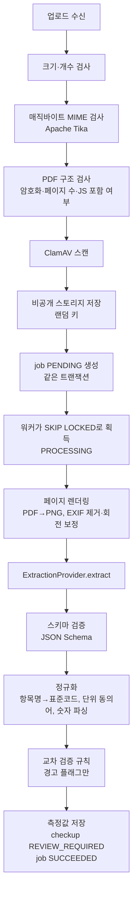

# OCR/AI 추출 파이프라인

> 산출물 7. 추출 파이프라인, 검증, 재시도 전략. 상태: **검토 요청**

## 1. 원칙

1. 문서에 없는 값을 만들지 않는다. 모르면 `null`.
2. 추출 결과는 항상 `REVIEW_REQUIRED`로 저장되며, 사용자 확정 전에는 비교·대시보드에 쓰이지 않는다.
3. `confidence`는 UI의 "확인 필요" 표시용 참고 신호다. 정확도나 의료적 확실성으로 표기하지 않는다.
4. 제공업체에는 필요한 페이지 이미지/파일만 보낸다. 사용자 이메일·이름 등 계정 정보는 보내지 않는다.

## 2. 단계



### 2.1 업로드 검증 (동기, API)

| 검사 | 규칙 | 실패 코드 |
|---|---|---|
| 개수 | PDF 1개 또는 이미지 1~20장, 혼합 불가 | `UPLOAD_INVALID_COMPOSITION` |
| 크기 | PDF ≤ 20MB, 이미지 ≤ 10MB/장 | `UPLOAD_TOO_LARGE` |
| 형식 | 매직바이트 기준 `application/pdf`, `image/jpeg`, `image/png`. 확장자 불일치 시 거부 | `UPLOAD_UNSUPPORTED_TYPE` |
| PDF | 페이지 ≤ 20, 암호화 불가, 손상 불가 | `UPLOAD_PDF_ENCRYPTED`, `UPLOAD_PDF_TOO_MANY_PAGES`, `UPLOAD_CORRUPTED` |
| 이미지 | 디코딩 가능, 픽셀 수 상한(디컴프레션 폭탄 방지, 예: 50MP) | `UPLOAD_CORRUPTED` |
| 악성코드 | ClamAV 감지 시 거부, 스캐너 장애 시 거부(fail-closed) | `UPLOAD_MALWARE_DETECTED`, `UPLOAD_SCAN_UNAVAILABLE` |
| 사용량 | 사용자당 일 10건 | `RATE_LIMITED` |

이미지 PDF 업로드가 큰 경우를 대비해 MVP는 **API 경유 multipart 업로드**(최대 ~200MB 요청 크기 제한 아래)로 시작한다. 이후 대용량/모바일 회선 대응이 필요하면 presigned PUT + 서버 측 사후 검증으로 전환한다.

### 2.2 작업 큐

```sql
-- 워커 획득 쿼리
SELECT id FROM document_analysis_jobs
WHERE status = 'PENDING' AND next_attempt_at <= now()
ORDER BY created_at
FOR UPDATE SKIP LOCKED
LIMIT 1;
```

- 획득 시 `status=PROCESSING`, `locked_at=now()`, `locked_by=<instance-id>`, `attempt_count += 1`.
- **좀비 작업 회수**: `PROCESSING`이고 `locked_at < now() - 5분`이면 `PENDING`으로 되돌림(시도 횟수 유지).
- 동시성: 인스턴스당 워커 스레드 2개(설정값).

### 2.3 재시도·타임아웃

| 오류 유형 | 예 | 처리 |
|---|---|---|
| 일시적 | 제공업체 5xx, 타임아웃, 429 | 자동 재시도. `next_attempt_at = now + 30s × 2^(n-1)` (30s, 60s, 120s), 최대 3회 |
| 영구적 | 지원하지 않는 문서, 판독 불가, 스키마 위반 반복 | 즉시 `FAILED`, `error_code` 기록 |
| 내부 | 스토리지 읽기 실패 | 일시적으로 취급 |

- 최종 실패 시 검진은 `ANALYSIS_FAILED` → UI에서 **재시도**(새 job 생성, 같은 문서) 또는 **직접 입력**(빈 측정값으로 `REVIEW_REQUIRED` 전환) 제공.
- 작업 1회 타임아웃 3분.
- `error_code`는 사용자 메시지로 매핑되는 열거형. 원문 응답·문서 내용은 저장/로그 금지.

### 2.4 멱등성

- 결과 저장은 하나의 트랜잭션: 해당 검진의 `source='EXTRACTED'`이며 아직 `PENDING` 리뷰 상태인 측정값을 삭제 후 삽입 → 같은 job이 두 번 완료돼도 중복 없음.
- job 완료 처리 시 `UPDATE ... WHERE id=? AND status='PROCESSING' AND locked_by=?` 조건으로, 회수된 뒤 늦게 끝난 워커의 결과를 버린다.
- 이미 `CONFIRMED`된 검진에는 추출 결과를 덮어쓰지 않는다(재분석은 확정 전만 허용).
- 업로드 요청은 `Idempotency-Key`로 중복 생성 방지.

## 3. 제공업체 어댑터

```java
public interface ExtractionProvider {
    String name();                       // "fake", "vendor-x"
    ExtractionResult extract(ExtractionRequest request) throws ExtractionException;
}

record ExtractionRequest(List<PageImage> pages, String locale) {}
record ExtractionResult(
    LocalDate examDate,                  // nullable
    String institutionName,              // nullable
    List<ExtractedItem> items,
    String providerModelVersion
) {}
record ExtractedItem(
    String rawName, String rawValue, String rawUnit,
    String rawReferenceText, String rawJudgement,
    int sourcePage, BoundingBox bbox,    // bbox nullable
    Double confidence                    // nullable
) {}
```

- 제공업체는 **원문 문자열만** 반환하게 하고, 숫자 파싱·표준 코드 매핑·범위 파싱은 우리 코드(결정적, 테스트 가능)에서 한다.
- `FakeExtractionProvider`: 테스트/로컬용. 파일 해시별 고정 픽스처 반환, 실패 시나리오 주입 가능.
- 후보 평가는 Sprint 3 전에 진행: (a) 국내 리전 OCR + 규칙 기반 표 파싱, (b) 클라우드 Document AI, (c) 멀티모달 LLM 구조화 출력. 평가 기준은 §5.

### LLM을 쓰는 경우의 추가 통제
- 구조화 출력(JSON Schema) 강제, 스키마 위반 시 1회 재요청 후 실패 처리.
- 프롬프트에 "문서에 보이지 않는 값은 null", "계산·추론 금지", "해석·판정 문장 금지" 명시.
- 사후 검증: 추출된 `rawValue` 문자열이 OCR 텍스트(제공되는 경우)에 실제로 존재하는지 확인, 없으면 `confidence` 무시하고 "확인 필요".
- 데이터 보관·학습 미사용(zero retention) 조건 확인 전 운영 사용 금지.

## 4. 정규화 규칙

| 대상 | 규칙 |
|---|---|
| 항목명 → 코드 | `measurement_definitions.aliases`(예: "공복혈당", "혈당(공복)", "Glucose(FBS)", "FBS") 정확 일치 → 공백·괄호·대소문자 정규화 후 일치. **유사도(퍼지) 매칭은 자동 확정하지 않고** 후보로만 제시 |
| 숫자 | 천 단위 콤마 제거, 전각 숫자 변환. `<5`, `>300` 같은 부등호 값은 `value_type=TEXT`로 원문 보존 |
| 혈압 | `120/80` → SBP 120, DBP 80 |
| 단위 | 동의어 사전(`mg/dl`→`mg/dL`, `IU/L`↔`U/L`는 **동의어 아님**—보수적으로 별도 처리) |
| 참고범위 | `70-99`, `70~99`, `<100`, `≤99`, `≥60`, `M: 13-17 / F: 12-16` 패턴. 성별 분기 등 해석 불가 시 `reference_text`만 저장 |
| 검진일 | `YYYY.MM.DD`, `YYYY-MM-DD`, `YYYY년 M월 D일`. 미래 날짜·1990년 이전은 경고 |

## 5. 확인 필요(needs_review) 플래그

UI의 "확인 필요 N개"는 다음 중 하나라도 해당하면 표시한다. 의료적 판단이 아닌 **추출 품질** 신호다.

- 표준 코드 미매핑
- 값 파싱 실패 또는 단위 누락
- 단위가 표준 단위와 다름
- 제공업체 confidence < 0.8 (임계값은 평가 후 조정)
- 생리적으로 기재 오류가 의심되는 범위(예: 공복혈당 0 또는 5000) — 자리수 오류 탐지용 넓은 범위, 결과 판정에 사용하지 않음
- 같은 코드가 한 문서에서 서로 다른 값으로 2회 이상 추출됨

## 6. 정확도 평가

- 평가셋: 합성·익명화 검진지 우선, 양식별 최소 10건 목표. 정답 라벨(JSON)과 함께 `backend/src/test/resources/extraction-eval/`(합성본만) 또는 저장소 외부(실데이터)에 보관.
- 지표(필드별): 검진일 정확도, 항목 재현율/정밀도, 값 정확 일치율, 단위 정확 일치율, 참고범위 일치율.
- **출시 차단 오류** 별도 집계: 자리수 오류, 단위 오류, 다른 항목 값 뒤바뀜, 타인 데이터 혼합.
- 평가 스크립트는 제공업체 교체 시 재실행 가능한 Gradle 태스크로 둔다(Sprint 3).
