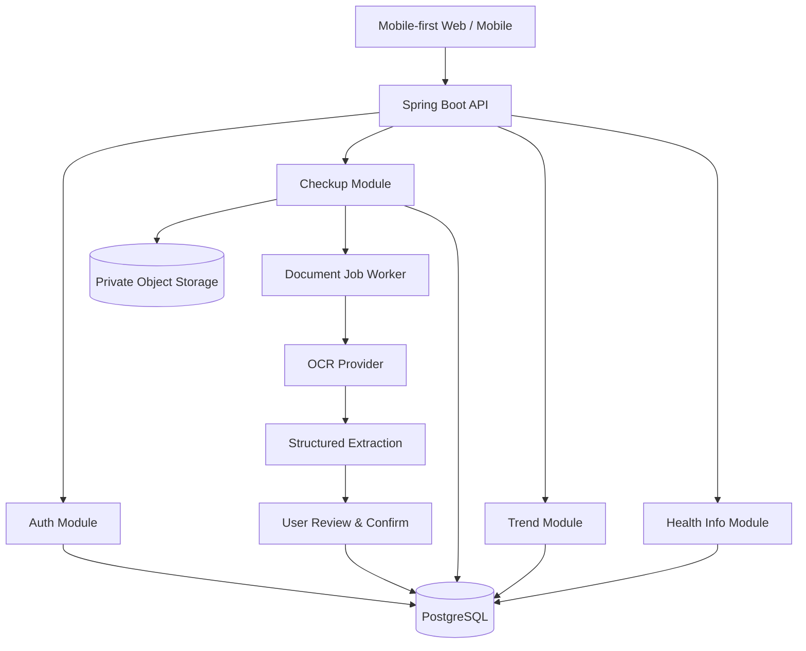
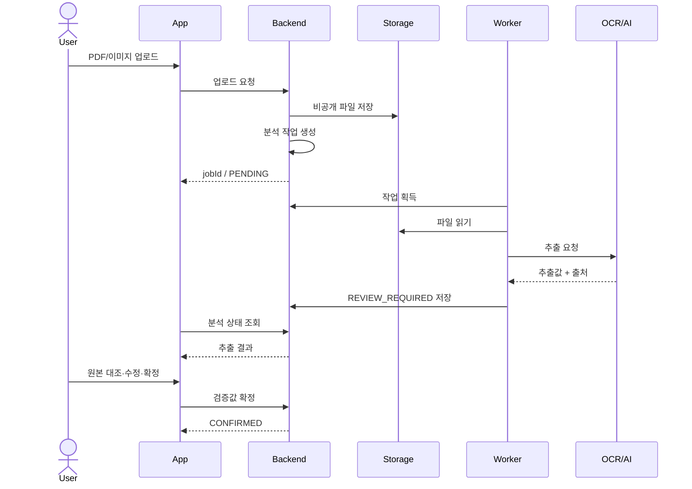
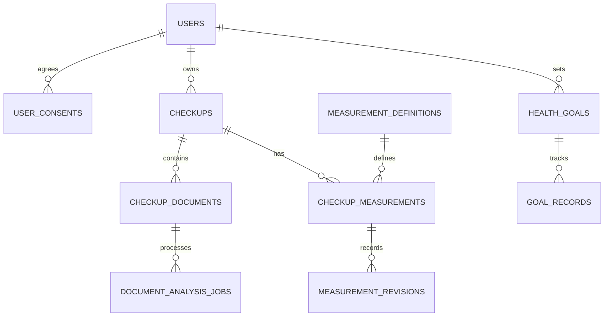

# 검진노트 (Gumjin Note) — 제품 요구사항 정의서 (PRD)

버전: 1.0 · 작성일: 2026-10-29 · 대상: AI 코딩 에이전트(Claude Code, Codex) 및 개발팀

> 슬로건: 건강검진은 1년에 한 번, 건강관리는 매일.

## 0. 에이전트에게 먼저 전달할 지시

이 문서는 구현의 기준이다. 처음부터 전체 기능을 구현하지 말 것. 먼저 요구사항의 모호점, 아키텍처, ERD, API 계약, 화면 흐름, 보안 위험, 구현 순서를 `docs/`에 Markdown으로 정리하고 승인을 요청한다. 승인 이후 작은 수직 기능 단위로 개발하고 자동 테스트 결과를 제시한다. 의료적 진단·처방 기능을 임의로 추가하지 않는다.

## 1. 서비스 개요

검진노트는 건강검진 PDF/사진에서 검진일·검사 항목·수치·단위·참고범위를 추출해 사용자가 확인·수정한 뒤 안전하게 보관하고, 과거 검진과의 변화를 보여주는 개인 건강기록 앱이다. 검사 항목의 의미를 쉬운 언어로 설명하며, 이후 일반적인 생활 습관 목표 관리로 확장한다.

- 핵심 가치: 기록 → 확인 → 이해 → 비교 → 실천
- 1차 타깃: 정기 건강검진을 받는 30~50대 성인(가설, 사용자 조사로 검증)
- 차별화 가설: 다양한 형식의 검진지를 정확하게 구조화하고, 원본 대조·수정·추이 비교를 한 번에 제공한다.
- 제품 경계: 의료적 진단이나 치료를 대체하지 않는다. 위험도 예측·처방·의약품 권고는 별도 규제 검토 전 구현 금지.
- 사업 모델: 초기 무료, 유료 기능은 사용성 검증 후 실험. 자신의 기록 열람·삭제를 유료 기능에 묶지 않는다.

### 성공 가설

1. 사용자는 결과지를 수동 입력하는 것보다 업로드·검증 흐름을 선호한다.
2. 과거 검진과의 비교는 단순 파일 보관보다 더 큰 가치를 준다.
3. 검사 항목의 쉬운 설명은 결과 이해도를 높인다.

## 2. 사용자 및 시나리오

| 페르소나 | 문제 | 핵심 경험 |
|---|---|---|
| 35세 직장인(가상) | 공복혈당·지질 변화가 궁금하지만 이전 기록을 찾기 어려움 | 2개 연도 업로드 → 추출 확인 → 항목별 그래프 |
| 45세 기록 관리자(가상) | 검진기관별 파일이 분산됨 | 여러 검진기관 문서 통합 → 연도별 목록 |
| 가족 기록 관리자(향후) | 가족의 검사 이력을 함께 보고 싶음 | 본인별 동의·권한 모델 수립 후 후속 개발 |

핵심 사용자 여정: 가입 → 파일 선택/촬영 → 업로드 → 분석 진행 → 추출값과 원본 대조 → 사용자 확정 → 대시보드 → 검진 상세 → 연도별 추이 → 검사 항목 설명.

## 3. 출시 범위 및 우선순위

| 단계 | 포함 | 제외 |
|---|---|---|
| MVP (P0) | 이메일 인증·로그인, 파일 업로드, 비동기 분석, 항목 추출, 사용자 검증·수정, 검진 기록 CRUD, 대시보드, 항목별 연도 비교, 개인정보 관리 | AI 채팅, 가족 계정, 결제, 웨어러블 연동 |
| P1 | 검사 항목 설명 콘텐츠, 정교한 추이 그래프, 알림/온보딩 개선, 추가 검진 양식 지원 | 질병 위험도 예측 |
| P2 | 사용자가 선택하는 걷기·수면·운동 등 목표, 실천 기록, 주간 요약 | 의료적 개인 처방 |

출시 플랫폼 의사결정: 개인 개발 효율을 위해 첫 버전은 모바일 반응형 Next.js 웹을 기본 제안한다. 앱스토어 우선 출시가 확정되면 React Native + Expo를 첫 클라이언트로 선택한다. 두 클라이언트를 동시에 구현하지 않는다. API는 추후 모바일 앱에서 재사용할 수 있도록 설계한다.

## 4. 기능 요구사항 및 수용 기준

### AUTH-001 계정 및 접근 통제 (P0)
- 이메일 가입/인증, 로그인/로그아웃, 비밀번호 재설정, 탈퇴, 동의 이력 관리.
- 인증되지 않은 사용자는 개인 건강정보에 접근할 수 없다.
- 모든 건강정보 리소스는 사용자 소유권을 서버에서 검증한다(IDOR 방지).
- 비밀번호는 적절한 적응형 해시 알고리즘으로 저장하며 로그인 시도 제한을 적용한다.
- 세션/토큰 저장 방식은 클라이언트 형태와 위협 모델을 기준으로 결정한다.

### CHECKUP-001 문서 업로드 (P0)
- PDF/JPG/PNG, 다중 이미지 지원. 모바일 카메라 촬영은 클라이언트 기능으로 제공.
- 초기 제안 제한: PDF 20MB, 이미지당 10MB, 최대 20페이지(운영 실험 후 조정).
- 확장자뿐 아니라 MIME/실제 파일 형식 검사, 악성 파일 검사, 비공개 오브젝트 저장, 랜덤 저장 키 사용.
- 진행률/실패/재시도/취소 UI를 제공하고 업로드 완료 후 비동기 분석 작업을 생성한다.
- 파일과 분석 결과는 해당 사용자만 접근할 수 있다.

### AI-001 문서 분석 및 구조화 (P0)
- 문서에서 검진일, 기관, 검사 항목 원문명, 값, 단위, 참고범위, 원문 판정, 출처 페이지/위치를 추출한다.
- 초기 대상: 키·체중·BMI·허리둘레, 수축기/이완기 혈압, 공복혈당·HbA1c, 총콜레스테롤·HDL·LDL·중성지방, AST·ALT·GGT, 크레아티닌·eGFR.
- 미추출값은 null, 미지원 항목은 원문을 보존한다. 문서에 없는 수치를 생성하지 않는다.
- 추출 모델의 confidence는 참고 신호일 뿐 정답 확률이나 의료적 확실성을 의미하지 않는다.
- 분석 상태: PENDING → PROCESSING → REVIEW_REQUIRED → CONFIRMED; 실패 시 FAILED, 삭제 시 DELETED.
- 동일 작업 재시도는 중복 검진 기록을 만들지 않도록 멱등성을 보장한다.

### CHECKUP-002 추출 결과 검증 (P0)
- 원본 문서(페이지)와 추출 결과를 나란히 확인한다.
- 항목명/값/단위/검진일 수정, 누락 항목 수동 추가, 항목 제외 기능을 제공한다.
- 사용자가 확정하기 전에는 추출값을 검진 비교·설명 기능의 신뢰 가능한 입력으로 사용하지 않는다.
- 원본 추출값과 확정값, 수정 시각/주체를 별도 보존한다.
- 분석 실패 시 재시도 또는 수동 등록 경로를 제공한다.

### HISTORY-001 검진 기록 관리 (P0)
- 검진일 내림차순 목록, 연도/기관 필터, 상세, 수정, 삭제, 원본 파일 열람.
- 검진일과 등록일은 별도 저장하며 같은 연도에 여러 검진이 있을 수 있다.
- 삭제 시 파일·파생 데이터·작업·백업에 대한 처리 정책을 사용자에게 안내한다.

### DASHBOARD-001 홈 (P0)
- 최신 검진 날짜·기관·확정 항목 수, 이전 검진 대비 변화 카드, 새 검진 등록 CTA.
- 기록이 없으면 업로드를 유도하는 Empty State, 분석 중에는 상태 카드를 제공한다.
- 수치 증가 자체를 무조건 위험/빨간색으로 표시하지 않는다.

### TREND-001 변화 비교 (P0)
- 표준 검사 항목 코드 기준으로 시간순 그래프와 이전 검사 대비 절대 변화량 표시.
- 단위가 다르거나 검사법·검체·참고범위 차이로 비교가 부적절한 경우 자동 비교를 보류하고 이유를 안내한다.
- 검사 당시 참고범위와 측정일을 함께 보여준다. 데이터가 1개면 그래프 대신 단일 기록을 표시한다.
- 증가·감소를 의학적 개선·악화로 단정하지 않는다.

### INFO-001 검사 항목 설명 (P1)
- 항목 정의, 검사 목적, 결과 해석 시 유의점, 일반적인 생활 습관 정보를 제공한다.
- 출처·검토일·버전·의료 전문가 검토 여부를 저장한다.
- 검증된 콘텐츠를 우선 제공하며 LLM은 출처 있는 내용을 이해하기 쉽게 재서술하는 보조 역할로 제한한다.

### GOAL-001 건강관리 목표 (P2)
- 걷기·운동·수면·식습관 등 목표 생성/수정/삭제, 일일 실천 기록, 주간 달성률.
- 초기 목표는 사용자가 선택하며 AI가 치료나 개인별 처방을 지시하지 않는다.

## 5. 화면 설계

| ID | 화면 | 주요 구성 | 우선순위 |
|---|---|---|---|
| SCR-001 | 온보딩 | 서비스 가치, 데이터 처리 안내, 시작하기 | P1 |
| SCR-002 | 가입/로그인 | 이메일 인증, 오류·복구 | P0 |
| SCR-003 | 홈 | 최신 검진 카드, 변화 요약, 업로드 CTA | P0 |
| SCR-004 | 업로드 | 파일 선택·촬영·제한 안내·진행률 | P0 |
| SCR-005 | 분석 진행 | 작업 상태, 실패/재시도 | P0 |
| SCR-006 | 추출 검증 | 원본 미리보기, 항목 편집, 확정 | P0 |
| SCR-007 | 기록 목록 | 연도별 목록, 검색/필터 | P0 |
| SCR-008 | 검진 상세 | 기관·검진일·항목·원본·삭제 | P0 |
| SCR-009 | 건강 변화 | 항목 선택, 추이 그래프, 단위/참고범위 | P0 |
| SCR-010 | 항목 설명 | 쉬운 설명, 출처, 유의사항 | P1 |
| SCR-011 | 목표 | 목표 생성, 주간 체크인 | P2 |
| SCR-012 | 마이페이지 | 계정, 동의, 내보내기, 삭제 | P0 |

홈 와이어프레임 (표시 수치는 모두 가상 데이터)

```
┌─────────────────────────────┐
│ 검진노트              설정  │
│ 내 건강 기록을 한눈에       │
│ ┌─────────────────────────┐ │
│ │ 최근 검진 · 2026.10.01  │ │
│ │ 확인한 항목 18개        │ │
│ │ [검진 결과 보기 →]      │ │
│ └─────────────────────────┘ │
│ 지난 검진과 달라진 항목     │
│ ┌─────────────────────────┐ │
│ │ 공복혈당 98 → 105 mg/dL │ │
│ │ [추이 보기]             │ │
│ └─────────────────────────┘ │
│ [+ 건강검진 등록하기]      │
│ 홈  검진기록  건강변화  MY │
└─────────────────────────────┘
```

검증 화면 와이어프레임

```
┌─────────────────────────────┐
│ 추출 결과 확인             │
│ 18개 항목 / 확인 필요 2개  │
│ [원본 문서 보기]           │
│ 공복혈당                  │
│ [ 105 ] [mg/dL] [수정]     │
│ 총콜레스테롤              │
│ [ 215 ] [mg/dL] [수정]     │
│ [+ 항목 직접 추가]        │
│ [검증 후 저장]            │
└─────────────────────────────┘
```

## 6. 디자인 시스템

- 컨셉: Clean · Calm · Friendly · Trustworthy · Accessible.
- 색상: Primary #18B89A, Dark Green #087F6D, Background #F7F9FA, Surface #FFFFFF, Primary Text #172B3A, Secondary Text #667788, Info #3B82F6, Warning #F59E0B, Error #EF4444.
- 레이아웃: 모바일 우선, 8px 간격 체계, 12~16px 카드 모서리, 넉넉한 여백, 일관된 아이콘.
- 접근성: WCAG 2.2 AA 지향, 색상 외 텍스트·아이콘 병행, 키보드 접근, 스크린리더 레이블, 터치 타깃 최소 약 44×44pt 지향.
- 상태 설계: Loading/Skeleton, Empty, Error, Retry, Success, Offline(가능 범위), Permission Denied.
- 그래프: 날짜·단위·참고범위·원본 데이터 출처를 명시하고 상승/하락을 무조건 좋음/나쁨으로 분류하지 않는다.
- 카피 톤: 비판단적·명료한 한국어. 공포 마케팅, 확정적 질병 표현 금지.

## 7. 권장 기술 아키텍처

| 영역 | 기본 선택 | 비고 |
|---|---|---|
| Backend | Java 21 + Spring Boot + Spring Security | 모듈형 모놀리스 |
| Database | PostgreSQL + Flyway | 마이그레이션 버전 관리 |
| Frontend (1차) | Next.js | 모바일 반응형 웹 우선 제안 |
| Mobile (후속 또는 대안) | React Native + Expo | 출시 우선순위 확정 후 결정 |
| File Storage | S3 호환 비공개 Object Storage | 짧은 수명의 서명 URL 등 통제 |
| OCR/추출 | 교체 가능한 Document AI Provider | 실제 검진지 평가 후 선정 |
| AI 설명 | 검증된 콘텐츠 + 필요시 LLM | 자유 진단 생성 금지 |
| 비동기 처리 | DB 기반 작업 큐/워커부터 시작 | 규모 확대 시 큐 도입 검토 |
| API | REST + OpenAPI | /api/v1 |
| Test | JUnit, Testcontainers, API/E2E 도구 | 핵심 흐름 자동화 |
| 배포 | Docker + CI/CD | 환경별 비밀정보 분리 |



권장 모듈: auth, user, checkup, document, measurement, trend, healthinfo, goal(P2), global.
패키지는 기능별 controller/service/domain/repository로 단순하게 나누되 복잡성이 실제로 증가할 때만 세분화한다.

비동기 분석 시퀀스



## 8. 데이터 모델 초안

| 테이블 | 주요 컬럼(예시) | 설명 |
|---|---|---|
| users | id, email, password_hash, status, created_at | 계정 |
| user_consents | id, user_id, consent_type, version, agreed_at, revoked_at | 동의 이력 |
| checkups | id, user_id, exam_date, institution_name, status, created_at | 검진 이벤트 |
| checkup_documents | id, checkup_id, storage_key, mime_type, size_bytes, uploaded_at | 원본 문서 |
| document_analysis_jobs | id, document_id, status, attempt_count, error_code, created_at | 분석 작업 |
| measurement_definitions | id, code, name_ko, canonical_unit, category | 표준 항목 사전 |
| checkup_measurements | id, checkup_id, definition_id, raw_name, raw_value, confirmed_value, unit, reference_min, reference_max, source_page, status | 항목 결과 |
| measurement_revisions | id, measurement_id, before_value, after_value, changed_by, changed_at | 수정 이력 |
| health_information | id, definition_id, content, source, version, reviewed_at | 검증된 설명 |
| health_goals | id, user_id, goal_type, target, status | 목표(P2) |
| goal_records | id, goal_id, record_date, achieved | 실천(P2) |

구현 시 보완할 사항: 값이 수치형이 아닌 검사 결과, 측정 단위 변환, 검사법 차이, 원본 판정, 범위의 포함/초과 기준, 다중 페이지 출처, 데이터 버전·동시 수정 충돌. 건강정보 컬럼과 원본 파일은 암호화·접근 통제 정책을 반영한다.



## 9. API 초안

| Method | Path | 설명 |
|---|---|---|
| POST | /api/v1/auth/signup | 가입 |
| POST | /api/v1/auth/login | 로그인 |
| POST | /api/v1/auth/logout | 로그아웃 |
| GET | /api/v1/users/me | 내 정보 |
| DELETE | /api/v1/users/me | 탈퇴 |
| POST | /api/v1/checkups/uploads | 파일 업로드/분석 시작 |
| GET | /api/v1/analysis-jobs/{id} | 분석 상태 |
| GET | /api/v1/checkups | 검진 목록 |
| GET | /api/v1/checkups/{id} | 검진 상세 |
| PATCH | /api/v1/checkups/{id} | 검진 메타데이터 수정 |
| DELETE | /api/v1/checkups/{id} | 검진 삭제 |
| GET | /api/v1/checkups/{id}/measurements | 추출 결과 |
| PUT | /api/v1/checkups/{id}/measurements | 검증/확정 |
| GET | /api/v1/measurements/{code}/trends | 항목 추이 |
| GET | /api/v1/health-information/{code} | 항목 설명(P1) |
| GET | /api/v1/dashboard | 홈 데이터 |

- 목록 API는 페이지네이션과 안정적인 정렬을 제공한다.
- 검증 실패는 필드별 오류를 제공하고 서버 예외는 Spring ProblemDetail 기반 일관된 오류 형식을 고려한다.
- 외부에 노출되는 ID를 추측하기 어렵게 설계하더라도 반드시 소유권을 검증한다.
- 문서 분석 작업 생성은 중복 요청과 재시도 정책을 정의한다.

추출 데이터 예시 (가상 데이터, 참고범위는 실제 문서와 검사기관 기준 우선)

```json
{
  "examDate": "2026-10-01",
  "institutionName": "OO건강검진센터",
  "measurements": [
    {
      "code": "FASTING_GLUCOSE",
      "rawName": "공복혈당",
      "value": 105,
      "unit": "mg/dL",
      "referenceRange": { "min": 70, "max": 99 },
      "sourcePage": 2,
      "confidence": 0.97,
      "reviewStatus": "PENDING"
    }
  ]
}
```

## 10. 개인정보·보안·의료 안전

1. 건강검진 정보는 민감정보로 취급한다. 적법한 처리 근거, 별도 동의 필요 여부, 처리방침, 보관 기간, 파기, 국외 이전/위탁 여부를 국내 법률 전문가와 검토한다.
2. 전송 구간 TLS, 저장 암호화, 비공개 버킷, 최소 권한, 비밀키 관리, 백업 암호화를 적용한다.
3. 업로드 파일은 크기·형식·악성코드 검사와 다운로드 권한 검증을 수행한다.
4. OCR/LLM 제공업체의 보관·학습 사용·하위 처리자·국외 처리 조건을 확인한다. 필요한 정보만 전송한다.
5. 민감정보를 애플리케이션 로그, 분석 도구, 오류 추적 서비스에 무단 수집하지 않는다.
6. 계정 삭제·검진 삭제 시 원본, 파생 데이터, 캐시, 백업에 대한 파기·복원 정책을 문서화한다.
7. 진단·치료·질병 위험 예측을 목적으로 하는 기능을 도입하기 전 의료기기 해당 여부 및 식약처 관련 규제를 검토한다.
8. 검사 결과 해석은 조건·검사법·연령·참고범위 등에 따라 달라질 수 있음을 명확히 안내한다.
9. 의료진 상담이 필요한 상황을 일반적인 생활 습관 조언으로 대체하지 않는다.
10. 건강정보를 광고 타기팅에 사용하지 않는 것을 기본 정책으로 한다.

## 11. 비기능 요구사항

| 항목 | 초기 목표/정책 |
|---|---|
| 일반 조회 API | p95 500ms 이하 목표, 운영 측정 후 조정 |
| 문서 분석 | 비동기, 상태 조회, 재시도·타임아웃·실패 사유 |
| 가용성 | 초기 목표 99.5%, 비용과 운영 여건에 따라 조정 |
| 보안 | 모든 개인 건강정보 API에서 서버 측 소유권 검증 |
| 관측성 | 작업 실패율, 처리 시간, 업로드 완료율, 오류율(개인정보 제외) |
| 접근성 | 주요 사용자 흐름 WCAG 2.2 AA 지향 |
| 복구 | 백업·복원 절차 문서화 및 실제 복원 테스트 |
| 비용 | 파일 저장·OCR/LLM 호출 비용과 사용량 상한 모니터링 |

## 12. QA 및 검증

| 테스트 | 수용 기준 |
|---|---|
| 정상 PDF/이미지 | 업로드·분석 작업 생성 성공 |
| 손상·악성·미지원 파일 | 안전하게 거부하고 명확한 오류 표시 |
| 타인 검진 ID 접근 | 조회·수정·삭제 모두 거부 |
| 잘못된 OCR 수치 | 사용자가 원본 대조 후 수정 가능 |
| 미검증 추출값 | 확정 전 추이 계산에 사용되지 않음 |
| 다른 단위/검사법 | 무리한 비교를 수행하지 않음 |
| 분석 중 네트워크 끊김 | 상태 재조회·안전한 재시도 가능 |
| 중복 업로드/재시도 | 중복 확정 데이터 생성 방지 |
| 삭제·탈퇴 | 데이터 처리 정책에 맞게 삭제 및 안내 |
| AI 응답 오류 | 안전한 오류 처리, 허위 의학적 단정 금지 |

OCR 평가 계획: 동의와 적법한 사용권한이 확보된 다양한 양식의 검진지로 평가셋 구성. 검진일, 항목명, 수치, 단위, 참고범위별 정확도를 각각 측정한다. 실제 민감정보 대신 익명화/합성 문서를 우선 사용한다. 출시 차단 수준의 오류(수치 자리수 오류, 단위 오류, 타인 데이터 혼합)를 별도로 추적한다.

## 13. 단계별 개발 로드맵

1. Sprint 1 — 기반: 리포지토리, Spring Boot, PostgreSQL, Flyway, 인증, 공통 오류, Docker, CI.
2. Sprint 2 — 업로드: 비공개 스토리지, 파일 검증, 업로드 API, 문서·작업 엔티티.
3. Sprint 3 — 추출: OCR 어댑터, 비동기 워커, 표준 항목 매핑, 실패/재시도.
4. Sprint 4 — 검증·기록: 원본 대조 UI, 항목 수정·확정, 검진 목록/상세.
5. Sprint 5 — 대시보드·추이: 최신 검진 카드, 표준 항목 비교, 그래프, 비교 불가 안내.
6. Sprint 6 — 출시 준비: 권한/보안 테스트, OCR 정확도 평가, E2E, 삭제·백업·모니터링, 베타 테스트.
7. 후속: 검증된 검사 항목 설명, 목표 관리, 추가 양식, 모바일 네이티브 앱.

각 Sprint는 설계 → 구현 → 자동 테스트 → 수동 검수 → 문서 업데이트를 완료 조건으로 한다. 일정은 인력과 OCR 난도에 따라 별도 산정한다.

## 14. 성과 지표 및 사용자 검증

- 가입 → 첫 업로드 전환율
- 업로드 완료율 / 분석 성공률 / 사용자 검증 완료율
- 첫 업로드부터 대시보드 확인까지 소요 시간(초기 가설: 3분 이내 경험 지향)
- 항목별 추출 정확도(특히 수치·단위 오류)
- 두 번째 검진 등록률 및 30일 재방문율
- 사용자의 검진 결과 이해도 및 만족도
- 저장·OCR·LLM의 사용자당 처리 비용

검증 방법: 초기 사용자 10~20명 인터뷰 → 동의받은 샘플 문서 테스트 → 제한적 베타 → 핵심 퍼널 분석. 건강검진은 연 단위 이벤트이므로 DAU만으로 제품 가치를 평가하지 않는다.

## 15. 주요 위험 및 대응

| 위험 | 대응 |
|---|---|
| 검진 양식 다양성 | 초기 지원 양식 명시, 단계적 확대, 수동 보정 |
| OCR 숫자·단위 오류 | 원본 출처 표시, 사용자 확정 필수, 정확도 평가 |
| AI 환각 | 구조화 스키마 검증, 검증 콘텐츠 중심, 금지 행동 정책 |
| 건강정보 유출 | 암호화, 소유권 검증, 최소 수집, 보안 테스트 |
| 규제 불확실성 | 출시 전 법률·의료기기 해당성 검토 |
| AI 호출 비용 | 비동기 큐, 사용량 제한, 캐싱·재처리 정책 |
| 낮은 재방문 | 변화 비교의 유용성 검증, 후속 목표 관리 실험 |

## 16. 권장 저장소 구조

```
gumjin-note/
├── apps/
│   └── web/                  # 첫 클라이언트(권장)
├── backend/
│   ├── src/
│   ├── build.gradle
│   └── Dockerfile
├── infrastructure/
│   └── compose.yaml
├── docs/
│   ├── PRD.md
│   ├── ARCHITECTURE.md
│   ├── DATABASE.md
│   ├── API.md
│   ├── SECURITY.md
│   ├── UX.md
│   └── ROADMAP.md
├── .github/workflows/
├── AGENTS.md
└── README.md
```

## 17. 코딩 에이전트 개발 원칙

- 요구사항이 불명확하면 추측하지 말고 질문한다.
- 첫 단계에서 모든 기능을 일괄 구현하지 않는다.
- 모듈형 모놀리스로 시작하며 과도한 추상화/MSA를 피한다.
- DB 스키마는 Flyway로 관리하고 API 계약은 OpenAPI로 문서화한다.
- 핵심 로직·인가·업로드·분석 재시도에 자동 테스트를 작성한다.
- 로딩/빈 데이터/오류/권한 없음 상태를 모두 구현한다.
- AI 추출 결과는 사용자 확인 전 확정하지 않는다.
- 건강정보·토큰·원본 문서 내용을 로그에 출력하지 않는다.
- 의료적 진단·처방·질병 위험 예측을 임의로 구현하지 않는다.
- 구현마다 테스트 결과·남은 이슈·의사결정 사항을 보고한다.

## 18. 구현 전 확정할 질문

1. 첫 출시가 모바일 반응형 웹인가, iOS/Android 앱인가?
2. 어떤 건강검진 결과지 양식을 첫 번째로 지원할 것인가?
3. OCR/문서 분석 제공업체와 데이터 처리 조건은 무엇인가?
4. 원본 파일의 보관·삭제 정책은 어떻게 할 것인가?
5. 이메일 인증·세션 관리 방식은 무엇인가?
6. 서비스 출시 국가와 법률 검토 범위는 어디까지인가?
7. 데이터 내보내기 형식(PDF/CSV/JSON)과 삭제 UX는 어떻게 구성할 것인가?

문서 상태: 구현 착수용 PRD 초안. 사용자 인터뷰, 실제 검진 양식 테스트, 개인정보·의료 관련 법률 검토 결과에 따라 업데이트한다.
