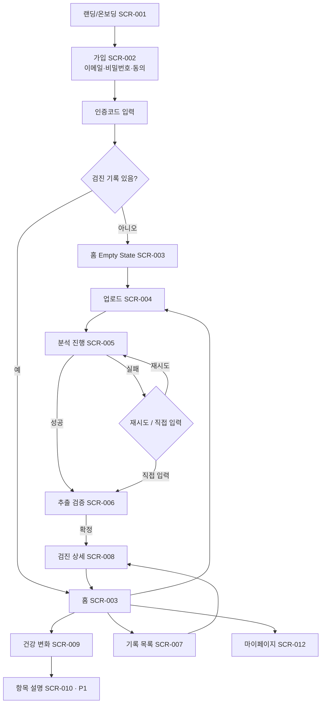

# 사용자 흐름 · 화면 구조 · 디자인 시스템

> 산출물 6. 상태: **검토 요청**

## 1. 핵심 사용자 흐름



분석 진행 화면은 이탈해도 된다. 홈의 "분석 중" 카드와 "확인이 필요한 검진" 카드로 복귀한다(MVP에는 푸시·메일 알림 없음).

## 2. 정보 구조 / 라우트 (Next.js App Router)

| 라우트 | 화면 | 인증 |
|---|---|---|
| `/` | 랜딩(비로그인) → 로그인 시 `/home` 리다이렉트 | — |
| `/signup`, `/signup/verify`, `/login`, `/password-reset`, `/password-reset/confirm` | SCR-002 | — |
| `/home` | SCR-003 | ✔ |
| `/checkups/new` | SCR-004 업로드 (+ "직접 입력" 링크) | ✔ |
| `/checkups/[id]/analysis` | SCR-005 | ✔ |
| `/checkups/[id]/review` | SCR-006 | ✔ |
| `/checkups` | SCR-007 | ✔ |
| `/checkups/[id]` | SCR-008 | ✔ |
| `/trends`, `/trends/[code]` | SCR-009 | ✔ |
| `/info/[code]` | SCR-010 (P1) | ✔ |
| `/me`, `/me/consents`, `/me/export`, `/me/delete` | SCR-012 | ✔ |

하단 탭: 홈 · 검진기록 · 건강변화 · MY (모바일). 데스크톱(≥1024px)은 좌측 내비게이션.

## 3. 화면별 상태

| 화면 | Loading | Empty | Error | 기타 |
|---|---|---|---|---|
| 홈 | 카드 스켈레톤 | "첫 건강검진 결과를 올려보세요" + 업로드 CTA + 지원 형식 안내 | 재시도 버튼 | 분석 중 카드, 확인 필요 카드 |
| 업로드 | 파일별 진행률 바 | — | 파일별 오류 사유(형식/크기/암호화/악성) + 다시 선택 | 취소 버튼, 업로드 중 이탈 경고 |
| 분석 진행 | 단계 표시(업로드 완료 → 분석 중 → 확인 준비) | — | 실패 사유 + 재시도 / 직접 입력 | "나가도 분석은 계속됩니다" |
| 추출 검증 | 스켈레톤 | 추출 0건: "항목을 찾지 못했어요" + 직접 추가 | 저장 실패, 버전 충돌(새로고침 안내) | 미저장 이탈 경고 |
| 기록 목록 | 리스트 스켈레톤 | 업로드 유도 | 재시도 | 연도 필터 |
| 건강 변화 | 차트 스켈레톤 | 확정 기록 없음 안내 | 재시도 | 1개: 단일 기록 카드, 비교 불가 구간 안내 |
| 공통 | — | — | 401 → 로그인, 403 미인증 → 인증 화면, 404 → "찾을 수 없는 기록" | 오프라인 배너 |

## 4. 추출 검증 화면 (SCR-006) 상세

모바일: 상단 탭 [항목 | 원본]. 항목 탭에서 "원본에서 보기"를 누르면 원본 탭으로 이동해 해당 페이지·영역(bbox 있으면) 하이라이트.
데스크톱: 좌 원본 뷰어 / 우 항목 목록 2단.

```
┌─────────────────────────────┐
│ ← 추출 결과 확인            │
│ 검진일 [2026-10-01]  기관 [OO센터] │
│ 18개 항목 · 확인 필요 2개   │
│ [ 확인 필요만 보기 ☐ ]      │
│ ─ 혈당 ─────────────────── │
│ ⚠ 공복혈당   확인 필요      │
│   단위가 표준과 달라요      │
│   [ 105 ] [mg/dL ▾]  p.2 원본│
│   참고범위 70–99 (문서 기재)│
│   [확인] [제외]             │
│ ─ 지질 ─────────────────── │
│ ✓ 총콜레스테롤  [215] mg/dL │
│ [+ 항목 직접 추가]          │
│ [검증 완료하고 저장] (n개 남음)│
└─────────────────────────────┘
```

- 각 항목은 확인/제외 중 하나를 선택해야 확정 버튼 활성화. "모두 확인" 일괄 버튼은 **확인 필요가 아닌 항목에만** 적용.
- 원문 판정("정상B" 등)은 "검진기관 판정: 정상B"로 출처를 붙여 표시, 앱 판정처럼 보이지 않게 한다.
- "확인 필요"는 노란 아이콘 + 텍스트 이유. 의료적 이상이 아닌 "추출 확인 필요" 의미임을 문구로 명확히.

## 5. 건강 변화 화면 (SCR-009)

- 항목 선택(카테고리별) → 선 그래프. 각 점: 날짜, 값+단위, 기관. 검사 당시 참고범위는 **점별 세로 범위 막대**로(기관마다 범위가 다를 수 있으므로 하나의 배경 밴드로 그리지 않음).
- 비교 불가 구간: 선을 끊고 "단위가 달라 비교하지 않았어요 (mg/dL ↔ mmol/L)" 안내.
- 변화량 표기: "+7 mg/dL (2025.10.02 → 2026.10.01)". 색은 중립(Secondary Text), 화살표는 방향만 표시.
- 차트 아래 동일 데이터 표(스크린리더·정확 확인용).
- 고정 문구: "수치 변화는 검사 조건·방법·기관에 따라 달라질 수 있어요. 결과 해석은 의료진과 상담하세요."

## 6. 디자인 시스템

### 6.1 색상 토큰과 대비 검토

| 토큰 | 값 | 용도 | 대비(흰 배경) | 비고 |
|---|---|---|---|---|
| `primary` | #18B89A | 브랜드, 아이콘, 큰 그래픽, 포커스 링 | 2.51:1 | **본문 텍스트·버튼 배경+흰 글자로 사용 불가(AA 미달)** |
| `primary-strong` | #087F6D | 주요 버튼 배경, 링크 텍스트 | 4.92:1 | 버튼 흰 글자 AA 충족 |
| `bg` | #F7F9FA | 페이지 배경 | — | |
| `surface` | #FFFFFF | 카드 | — | |
| `text` | #172B3A | 본문 | 14.55:1 | |
| `text-secondary` | #667788 | 보조 텍스트 | 4.61:1 (흰) / 4.36:1 (#F7F9FA) | 배경 위에서 AA 미달 → **#5E6E7E(4.96:1)로 소폭 어둡게 제안** |
| `info` | #3B82F6 | 정보 아이콘·배경 틴트 | 3.68:1 | 텍스트는 #1D4ED8(6.70:1) 사용 |
| `warning` | #F59E0B | "확인 필요" 아이콘·틴트 | 2.15:1 | 텍스트는 #92400E(7.09:1) 사용 |
| `error` | #EF4444 | 오류 아이콘 | 3.76:1 | 텍스트는 #B91C1C(6.47:1) 사용 |

대비는 WCAG 2.x 상대 휘도 공식으로 계산한 값이며, 구현 후 axe 자동 검사로 다시 확인한다. `error`/`warning` 색은 **추출·입력 오류에만** 쓰고 검사 수치 표시에는 쓰지 않는다.

### 6.2 타이포·간격·형태

- 폰트: Pretendard (자체 호스팅, OFL). 본문 16px/1.5, 보조 14px, 제목 20/24px. 수치는 `font-variant-numeric: tabular-nums`.
- 간격: 4/8/12/16/24/32/48 (8px 체계 + 4 보조).
- 모서리: 카드 16px, 입력·버튼 12px.
- 터치 타깃 ≥ 44×44px. 포커스 링 2px `primary` + 2px 오프셋.
- 아이콘: Lucide(선 아이콘, 1.75px) 단일 세트.

### 6.3 컴포넌트 (Sprint 1부터 점진적)

Button(primary/secondary/ghost/danger), TextField, CodeInput(6자리), Card, StatusBadge(분석 상태), ReviewFlag, MeasurementRow, FileDropzone, ProgressBar, Skeleton, EmptyState, ErrorState, Dialog(2단계 확인), BottomTab, TrendChart + DataTable, Toast.

### 6.4 카피 원칙

| 피하기 | 쓰기 |
|---|---|
| "공복혈당이 위험 수준입니다" | "공복혈당 105 mg/dL · 검진기관 참고범위 70–99" |
| "악화되었습니다" / "개선되었습니다" | "지난 검진보다 7 mg/dL 높아요" |
| "AI가 분석한 정확도 97%" | "자동으로 읽은 값이에요. 원본과 비교해 확인해주세요" |
| "지금 바로 관리하지 않으면…" | "궁금한 점은 의료진과 상담해보세요" |

## 7. 접근성 체크리스트 (WCAG 2.2 AA 지향)

- 모든 입력에 `<label>`, 오류는 `aria-describedby` + 텍스트.
- 상태 변경(분석 완료, 저장 완료)은 `aria-live="polite"`.
- 색상만으로 정보 전달 금지(확인 필요 = 아이콘 + 텍스트).
- 키보드만으로 업로드·검증·확정 완료 가능(Playwright 테스트로 보장).
- 차트는 대체 표 제공.
- 200% 확대, 320px 폭에서 가로 스크롤 없음.
- `prefers-reduced-motion` 존중.
